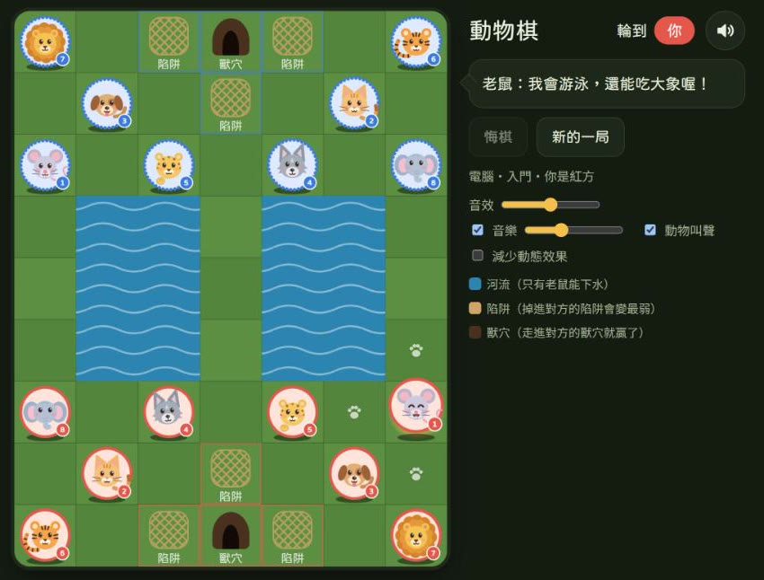

# 動物棋（jungle-chess）

給小朋友玩的鬥獸棋。可以和電腦下，也可以和家人在同一台裝置上輪流下；動物會眨眼、搖尾巴，走錯時用小朋友聽得懂的話說明原因。

**▶ 線上玩：<https://nekokiller.github.io/jungle-chess/>**



## 特色

- **六檔電腦對手**：入門、簡單、中等、困難、高手、大師。入門與簡單刻意保留失誤，小朋友贏得到。
- **兩個人輪流**：爸媽和小朋友、兄弟姊妹在同一台裝置上對下。
- **開局設定**：選對手、難度、紅方或藍方、誰先走。玩家執藍方時棋盤自動轉向，自己的動物一律在下方。
- **邊玩邊學**：
  - 點一隻動物，就用腳印標出能走的格子
  - 走錯時說明原因，例如「大象怕老鼠，不敢吃牠！」
  - 動物右下角有等級數字，不識字也能比大小
- **活潑的動物**：八隻 Q 版動物各有待機動作。跳河、下水、吃子、掉進陷阱都有動畫和表情。
- **聲音**：
  - 走棋、跳河、水花、吃子、陷阱、勝負都有音效，選取動物時有叫聲，還有輕柔的背景音樂
  - 音效、音樂、動物叫聲可以分別開關、調音量
- **貼心設定**：悔棋、「減少動態效果」開關；紅方實線外框、藍方珠子外框，色盲也分得出來；支援鍵盤操作。
- **離線也能玩**：可以安裝成 App（PWA），手機、平板直放或橫放都有對應的版面。

## 規則一頁看懂

- **棋盤**：7 欄 × 9 列。中間有兩條**河**，雙方底線中央各有一個**獸穴**，旁邊有三個**陷阱**。
- **等級**：象 8 ＞ 獅 7 ＞ 虎 6 ＞ 豹 5 ＞ 狼 4 ＞ 狗 3 ＞ 貓 2 ＞ 鼠 1。
- **走法**：每次上下左右走一格。
- **吃子**：大吃小、同級互吃。**老鼠可以吃大象，大象不能吃老鼠**。
- **河流**：
  - 只有老鼠能下水，在水裡的老鼠不能吃岸上的動物
  - 獅、虎可以跳過河，但河裡有老鼠擋著就跳不過去
- **陷阱**：走進對方的陷阱就變成最弱（等級 0），誰都能吃牠。
- **獲勝**：走進對方的獸穴、吃光對方的動物，或讓對方沒有路可走。同一局面重複三次就是平手。

完整規則與各家版本的差異見 [docs/evaluation/](docs/evaluation/)。

## 安裝到桌面或平板

1. 用 Chrome 或 Edge 打開[線上版](https://nekokiller.github.io/jungle-chess/)。
2. 安裝：
   - 電腦：按網址列右側的「安裝應用程式」
   - 平板、手機：在瀏覽器選單選「加到主畫面」
3. 之後點桌面或主畫面上的「動物棋」圖示就能玩。打開後是獨立視窗，沒有網址列和分頁。

**離線：** 第一次連網打開時會存好遊戲；背景音樂在第二次連網打開時才會存起來。建議連網打開兩次，之後沒有網路也能玩。

**更新：** 有新版本時，下次打開會自動更新，下棋到一半不會被重新整理。

## 開發

需要 Node.js 20.19 以上（或 22.12 以上）。

```bash
npm install
npm run dev        # 開發伺服器
npm test           # 單元測試（規則引擎、AI、提示文字、設定、音效取捨）
```

| 指令 | 用途 |
|---|---|
| `npm run dev` | 開發伺服器 |
| `npm run build` | 型別檢查並建置到 `dist/` |
| `npm run preview` | 預覽建置結果（可測試離線功能） |
| `npm run typecheck` | 只做型別檢查 |
| `npm test` ／ `npm run test:watch` | 執行測試 ／ 監看模式 |
| `npm run ai:selfplay` | AI 自我對弈，檢查各檔難度（較久，不在一般測試裡） |
| `npm run icons` | 由 `public/icon.svg` 產生 App 圖示 |

**技術：**

| 用途 | 使用 |
|---|---|
| 語言與建置 | TypeScript、Vite |
| 畫面與狀態 | React、Zustand |
| 動畫 | Motion |
| AI | Web Worker 執行 Alpha-Beta 搜尋 |
| 聲音 | Web Audio API |
| 離線與安裝 | vite-plugin-pwa |
| 測試 | Vitest |

### 專案結構

```text
src/
  engine/       規則引擎（純 TypeScript，不碰畫面）
  ai/           AI 搜尋、六檔難度、Web Worker
  session/      對局流程、悔棋、開局設定
  animation/    動畫導演：把引擎的事件依序播成動畫
  audio/        音效清單、混音規則、播放器、背景音樂
  components/   棋盤、動物、腳印、特效、對話框、設定視窗
  copy/         所有提示文字（兒童語氣）
tests/          單元測試
public/audio/   音效、動物叫聲、背景音樂（WAV 母檔＋MP3）
scripts/        AI 自我對弈、音效產生腳本（Python）
docs/           規則調查、技術架構、音效規劃、Git 規範
```

### 文件

- [規則與玩法調查](docs/evaluation/)：完整規則、規則差異、參考網站分析
- [技術架構](docs/architecture/README.md)：系統分層、規則引擎、AI、動畫、PWA、版面、開發階段
- [音效規劃](docs/architecture/audio-plan.md)：聲音風格、觸發時機、混音規則與驗收
- [Git 規範](docs/reference/Git規範.md)：commit 格式與分支規則（參與開發前請先看）

## 發佈

網站放在 GitHub Pages，**只會手動發佈**，合併到 `main` 不會自動更新網站。

要發佈時，到 GitHub 的 Actions 分頁，選「發佈到 GitHub Pages」，按 Run workflow。流程會先跑測試和建置，接著拿掉 WAV 母檔與音效試聽頁再上傳。詳見[技術架構 8.5 節](docs/architecture/README.md#85-發佈github-pages手動)。

## 素材

- **動物與棋盤**：程式繪製的 SVG。
- **音效、動物叫聲與背景音樂**：本專案原創，以程式合成；沒有使用第三方錄音、音樂或素材包。
- **重建音檔**：重建方式見 [public/audio/](public/audio/) 各目錄的說明。需要 Python 與 FFmpeg。
