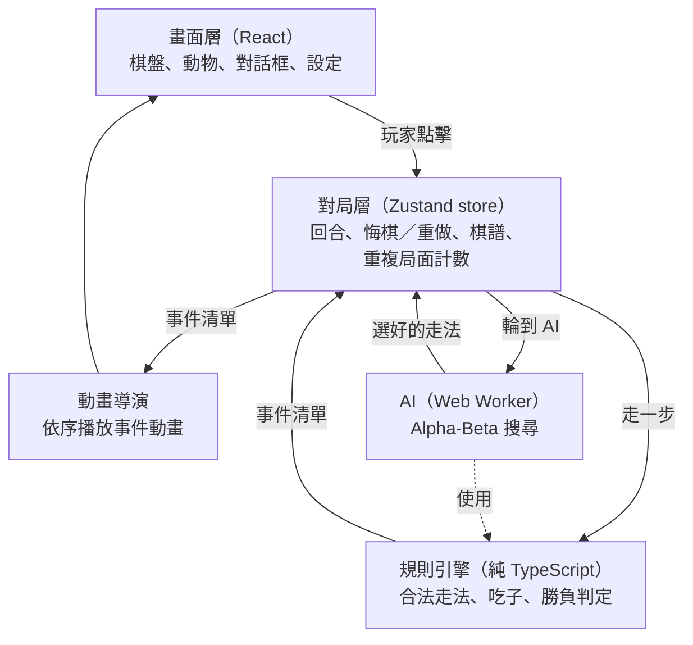

# 技術架構

> 建立日期：2026-10-18
> 規則依據：[docs/evaluation/01-game-rules.md](../evaluation/01-game-rules.md)（採用參考網站的 `doushouqi-xqv1` 規則）
> 動畫原型：[prototype/animal-prototype.html](prototype/animal-prototype.html)（用瀏覽器直接開啟；已試玩確認畫風與動畫）

## 1. 已定案的決策

| 項目 | 決定 | 理由 |
|---|---|---|
| 平台 | **網頁 + PWA** | 平板、手機、電腦都能玩，可以加到主畫面、離線玩，不必上架 App Store |
| 第一版模式 | **與 AI 對戰（六檔棋力）** | 同裝置雙人、線上雙人留到之後 |
| 美術 | **程式繪製的 Q 版 SVG 動物** | 原型已確認；風格一致、檔案小、身體部位可以分開動 |
| 動畫 | 每隻動物有專屬待機動作，加上共用的事件動畫 | 讓棋盤活潑，取代參考網站的純文字棋子 |

## 2. 技術選型

| 層 | 技術 | 說明 |
|---|---|---|
| 語言 | TypeScript | 規則邏輯多，型別可以減少錯誤 |
| 建置 | Vite | 開發伺服器快，設定少 |
| 畫面 | React | 元件化，動物、棋盤、對話框各自獨立 |
| 動畫 | Motion（原 Framer Motion）＋ CSS keyframes | 一次性動作（移動、跳河、吃子）用 Motion；持續循環的待機動作用 CSS |
| 狀態管理 | Zustand | 輕量，容易做悔棋／重做 |
| AI | Web Worker | 在背景執行緒計算，動畫不會卡 |
| PWA | vite-plugin-pwa | 離線快取、加到主畫面 |
| 測試 | Vitest | 規則引擎與 AI 的單元測試 |

## 3. 系統分層



**原則：**

1. **規則引擎完全不碰畫面**，只輸入盤面、輸出結果，可以單獨測試。AI 也直接呼叫同一套引擎，保證 AI 和玩家遵守相同規則。
2. **動畫由事件驅動**：引擎每走一步回傳一串事件，動畫導演照順序播放；播完才開放下一步操作。玩家和 AI 走棋用同一條流程。
3. **動物外觀包成單一元件**：`<Animal type side state face />`。之後要換美術（例如改用 Rive），只要換這個元件。

## 4. 目錄結構（規劃）

```text
src/
  engine/          規則引擎（不得 import React 或任何畫面程式）
    board.ts         棋盤地形：河流、陷阱、獸穴、初始盤面
    moves.ts         合法走法、跳河、吃子判定
    game.ts          走一步、勝負判定、局面雜湊
    events.ts        事件型別
  ai/
    search.ts        Alpha-Beta 搜尋、評估函式
    levels.ts        六檔難度參數
    worker.ts        Web Worker 入口
  session/
    store.ts         對局狀態、悔棋／重做、AI 回合
  animation/
    director.ts      事件 → 動畫序列
    timings.ts       動畫時間常數
  components/
    Board/           棋盤、格子、地形
    Animal/          八隻動物的 SVG、表情、待機動作
    Marks/           腳印、可吃子提示
    Effects/         星星、水花、塵土、彩帶
    Bubble/          對話框（走錯時的說明）
  copy/
    zh-TW.ts         所有提示文字（兒童語氣）
tests/
  engine/          規則單元測試（對照規則文件的檢查清單）
  ai/              AI 基本測試
```

## 5. 規則引擎

### 5.1 資料結構

- 座標：`{ row: 0–8, col: 0–6 }`，第 0 列是藍方底線、第 8 列是紅方底線。對外顯示用 `a1`～`g9`（紅方在下）。
- 盤面：9 × 7 陣列，每格放 `Piece | null`；`Piece = { type, side, id }`。
- `side`：`'red' | 'blue'`。
- 地形固定，不存在盤面裡，由 `board.ts` 的函式查詢（`isWater`、`trapOwner`、`denOwner`）。

### 5.2 走一步的輸出：事件

```ts
type GameEvent =
  | { kind: 'move'; pieceId: string; from: Pos; to: Pos }
  | { kind: 'jump'; pieceId: string; from: Pos; to: Pos }           // 獅、虎跳河
  | { kind: 'enterWater'; pieceId: string; at: Pos }
  | { kind: 'leaveWater'; pieceId: string; at: Pos }
  | { kind: 'capture'; pieceId: string; victimId: string; at: Pos }
  | { kind: 'enterTrap'; pieceId: string; at: Pos }                 // 進入敵方陷阱
  | { kind: 'leaveTrap'; pieceId: string; at: Pos }
  | { kind: 'gameOver'; winner: Side | null; reason: 'den' | 'allCaptured' | 'noMoves' | 'repetition' };
```

### 5.3 不合法走法的原因

點了不能走的格子時，引擎回傳原因，畫面再轉成兒童語氣的提示：

| 原因代碼 | 情境 | 提示範例 |
|---|---|---|
| `notAdjacent` | 不是上下左右一格 | 一次只能走上下左右一格喔！ |
| `ownPiece` | 目標有己方動物 | （改成選取那隻動物） |
| `ownDen` | 想進己方獸穴 | 那是自己的家（獸穴），自己人不能進去喔！ |
| `waterOnlyRat` | 非鼠想下水 | 只有老鼠會游泳喔！ |
| `bankCapture` | 跨水陸吃子 | 老鼠在水裡，不能咬岸上的動物喔！ |
| `jumpBlocked` | 跳河路徑有鼠 | 河裡有老鼠擋住，獅子跳不過去！ |
| `rankTooLow` | 等級不夠 | 貓咪比獅子小，吃不掉牠！ |
| `elephantVsRat` | 象想吃鼠 | 大象怕老鼠，不敢吃牠！ |

### 5.4 測試

[01-game-rules.md](../evaluation/01-game-rules.md) 第 7 節的 15 項檢查清單，每一項都要有對應的單元測試。另外補上初始盤面座標、三次重複判和、無合法走法判負的測試。

## 6. AI

- **演算法**：迭代加深的 Negamax ＋ Alpha-Beta 剪枝，搭配置換表與走法排序；時間到就用上一層的完整結果。
- **重複局面**：搜尋時把會造成第三次重複的走法評為和棋。
- **評估函式**（起始值，之後再調）：子力價值、往敵方獸穴前進的距離、靠近中路、站在敵方陷阱扣分、機動力。
- **六檔難度**（起始值，參考網站的參數）：

| 難度 | 搜尋深度 | 每步時間上限 | 隨機擾動 |
|---|---|---|---|
| 入門 | 1 | 20 ms | 大 |
| 簡單 | 2 | 50 ms | 中 |
| 中等 | 3 | 100 ms | 小 |
| 困難 | 4 | 250 ms | 無 |
| 高手 | 5 | 500 ms | 無 |
| 大師 | 6 | 1000 ms | 無 |

- **兒童調整**：入門、簡單兩檔要讓小朋友贏得到，除了隨機擾動，再加上「有一定機率忽略對方的威脅」或「偶爾漏看吃子」，實際比例在試玩後調整。
- **AI 思考時的表現**：AI 至少「想」0.5 秒再走，並讓 AI 方的動物做出東張西望的動作，避免瞬間出手讓小朋友來不及看。

## 7. 動畫

### 7.1 元件結構

每隻動物由外到內分成五層，各層負責不同的動畫，互不干擾（原型已驗證）：

| 層 | 負責 |
|---|---|
| piece | 在棋盤上的位置（格與格之間的水平移動） |
| hop | 跳躍的高度弧線 |
| lift | 被選中時浮起 |
| act | 一次性動作：壓扁伸展、搖頭、被吃掉縮小 |
| bob | 持續循環：呼吸、發抖、游泳、歡呼 |

### 7.2 表情與狀態

- **表情**（face）：一般、開心、害怕、被吃（眼睛變 > <）。
- **狀態**（state）：待機、被選中、在敵方陷阱（害怕）、歡呼。
- **眨眼**：每隻動物每 2～6 秒隨機眨一次。

### 7.3 每隻動物的待機動作

| 動物 | 待機動作 | 原型 |
|---|---|---|
| 象 | 甩鼻子、耳朵搧動 | 待做 |
| 獅 | 鬃毛蓬鬆擺動 | ✅ |
| 虎 | 尾巴擺動 | 待做 |
| 豹 | 舔爪子 | 待做 |
| 狼 | 豎耳朵、仰頭 | 待做 |
| 狗 | 搖尾巴、吐舌頭 | 待做 |
| 貓 | 甩尾巴、耳朵抖動、鬍鬚 | ✅ |
| 鼠 | 鼻子嗅嗅、鬍鬚抖動、耳朵 | ✅ |

### 7.4 事件動畫與時間（原型的數值）

| 事件 | 動畫 | 時間 |
|---|---|---|
| 移動 | 蹦跳一格，起跳與落地壓扁伸展 | 400 ms |
| 跳河 | 拋物線大跳、身體傾斜、落地揚起塵土 | 760 ms |
| 下水／上岸 | 濺起水花；在水裡下半身沉入水中、左右划水 | 水花約 0.6～0.9 秒 |
| 吃子 | 攻擊方撲過去；移動到 60% 時被吃方縮小旋轉、迸出星星與「噗！」 | 被吃 460 ms |
| 進入敵方陷阱 | 持續發抖、冒汗，等級數字變 0 | 持續 |
| 不能走 | 搖頭 | 560 ms |
| 進入獸穴 | 歡呼跳躍、灑彩帶，之後顯示勝利畫面 | 約 0.9 秒後顯示 |

### 7.5 無障礙

- 支援系統的「減少動態效果」設定，遊戲內也有開關：關閉待機循環與粒子特效，移動改為直接到位。
- 紅方用實線外框、藍方用珠子外框，色盲也分得出來。
- 每隻動物右下角顯示等級數字，不識字的小朋友也能比大小。
- 格子是可聚焦的按鈕，支援鍵盤操作。

## 8. 開發階段

| 階段 | 內容 | 完成條件 |
|---|---|---|
| M1 規則引擎 | 專案骨架、`engine/`、完整單元測試 | 檢查清單 15 項全部通過 |
| M2 棋盤與動物 | 棋盤 UI、八隻動物 SVG、表情與事件動畫、提示文字 | 可以兩邊手動走完一盤 |
| M3 AI | Web Worker、六檔難度、AI 回合流程、悔棋 | 六檔都能正常下完一盤，入門檔小朋友贏得到 |
| M4 完成第一版 | 開局設定（難度、紅藍、先後手）、PWA 離線、手機版面調整 | 平板上加到主畫面、離線可玩 |
| 之後 | 音效與動物叫聲、同裝置雙人、提示功能、線上雙人 | — |
